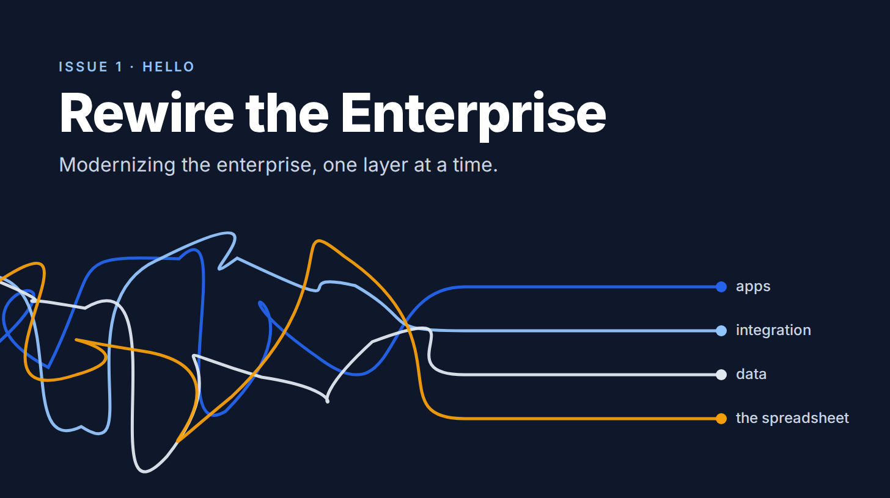
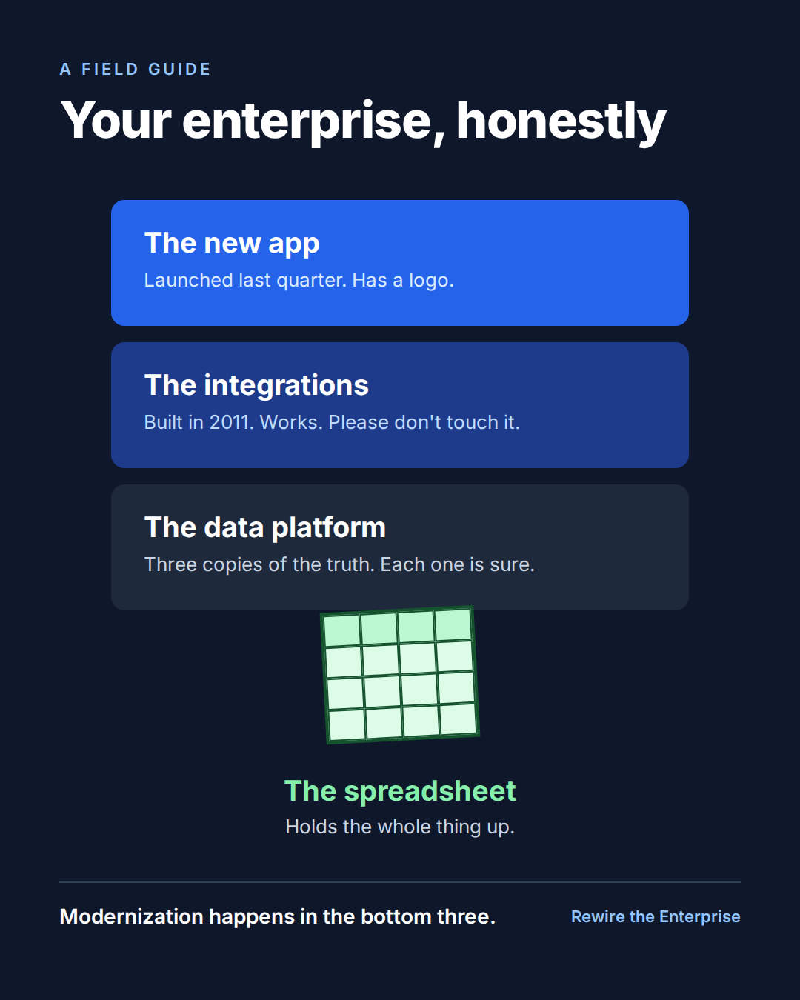
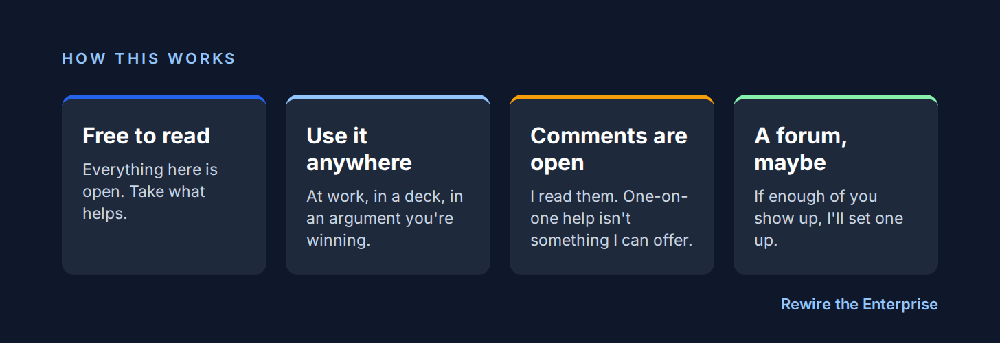

# S1: Hello from the spreadsheet holding up your company

Substack, Rewire the Enterprise, first post.

*A short introduction to Rewire the Enterprise, and what you'll find here.*

Every large organization I've worked with has one. A spreadsheet on a shared drive, quietly running something that matters. Its author left years ago. Everyone's a little scared to close it.

I've spent 25 years in the layers underneath that spreadsheet: custom applications, the integrations stitching them together, and the data platforms they all lean on. It's unglamorous work. It's also where modernization gets won or lost.

So I'm writing about it.

## What you'll find here

**Essays on modernization.** How big organizations decide what to keep, what to rebuild, and in what order. Trade-offs and the occasional mistake, mine included.

**Builds, written up as they happen.** Now and then I'll build something and show the work, rough edges and all.

## How this works

It's free to read, and you're welcome to use anything here that helps. I can't offer one-on-one help, but the comments are open and I read them. If enough of you show up, I'll set up a proper place to talk shop.

That's it for the hello. If your company runs on a file called FINAL_v7_REALLY_FINAL.xlsx, you're among friends.

Subscribe, and I'll see you in the next one.

Kallol
