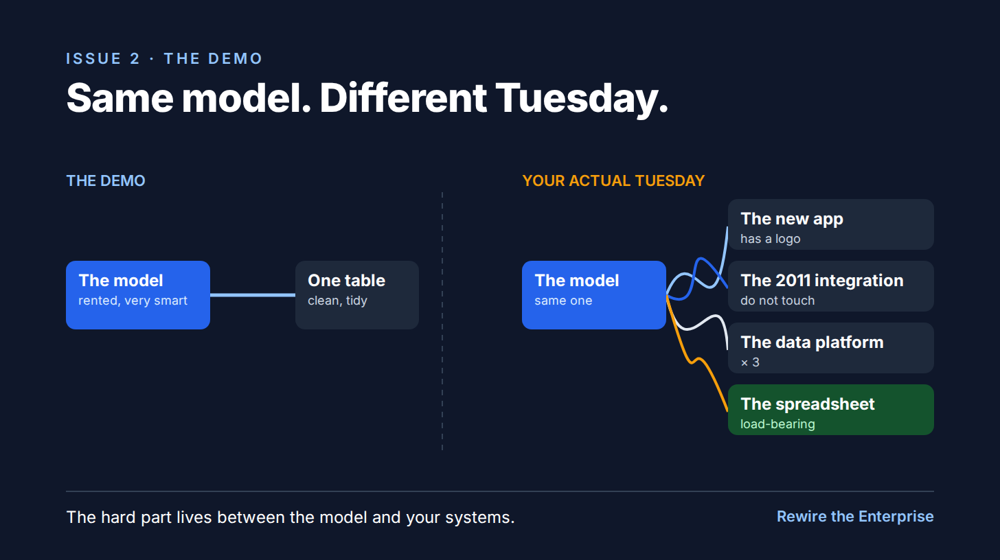

# S2: Every AI demo works. Then it meets your 2011 integration.

Substack, Rewire the Enterprise, Wed Oct 14, 2026, 5:00 PM CT.

*Why the model is rarely the hard part.*

Every AI demo I've watched this year went well. One clean table, one friendly question, a round of applause.

Then someone asks it to work on Tuesday's data.

Tuesday's data lives in the layers from the first post: the new app with the logo, the integration from 2011 that everyone's afraid to touch, the data platform with three copies of the truth, and the spreadsheet holding it all up.

The model is the same in both pictures. What changes is everything between it and your systems: finding the right data, getting permission to use it, and keeping a record of what it did.

That middle part is most of the work. Demos get to skip it.

Tomorrow: which part of this you can rent.

Kallol
