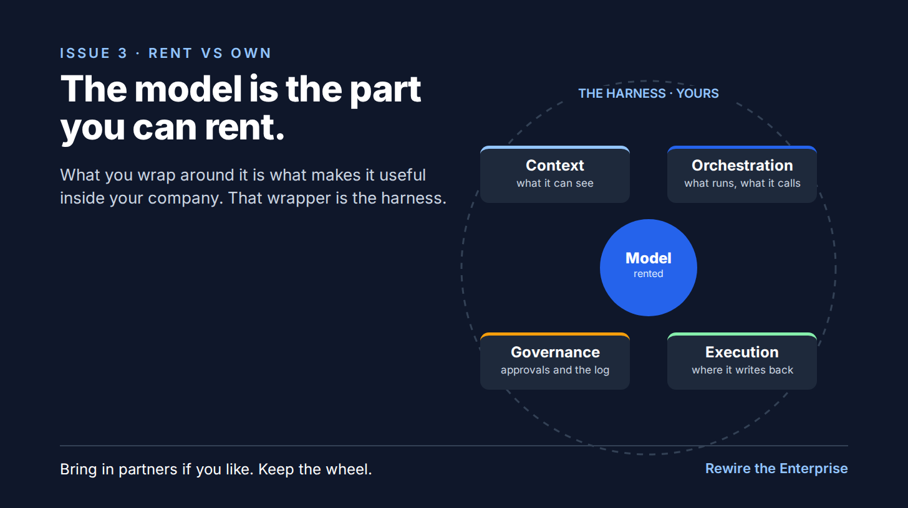

# S3: The model is the part you can rent

Substack, Rewire the Enterprise, Thu Oct 15, 2026, 5:00 PM CT.

*The part around it is the part to own.*

You don't have to build a model. You can rent a very good one by the token, and so can every competitor you have.

What makes a model useful inside your company is what you wrap around it. I split that into four parts:

- **Context.** What it can see: your documents, your data, and the rules that live in people's heads.
- **Orchestration.** Which agent runs, which tool it calls, which model answers.
- **Governance.** Who approved it, and a log you can hand an auditor.
- **Execution.** The systems it writes back to, and the people who check its work.

That wrapper is what I call the harness.

You'll probably swap models at least once in the next few years. The harness carries over, with everything you learned the hard way built into it.

Bring in partners to help build it if you like. Keep the wheel.

Next Thursday I'll make the longer case.

Kallol
