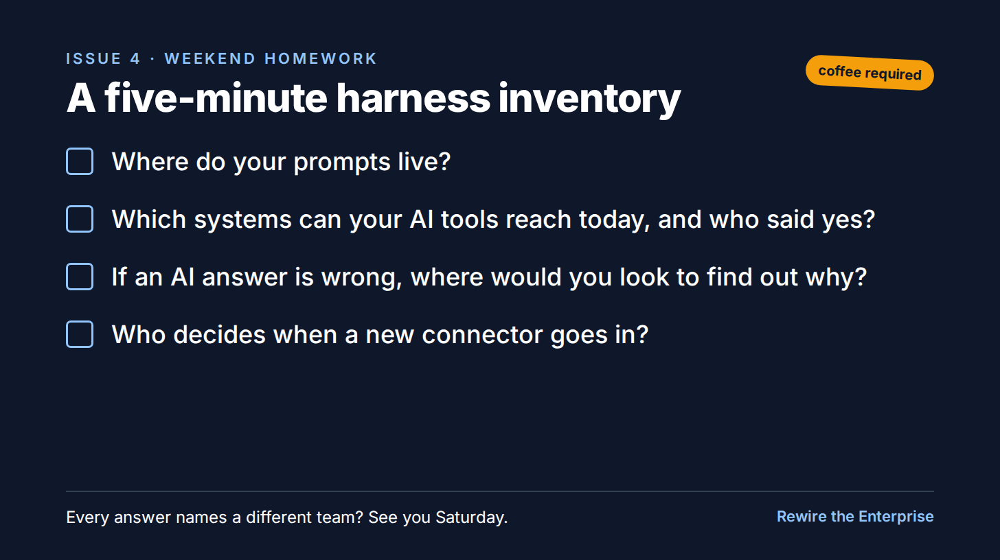

# S4: A five-minute harness inventory

Substack, Rewire the Enterprise, Fri Oct 16, 2026, 5:00 PM CT.

*Four questions for the weekend, before Saturday's long read.*

A small exercise before tomorrow. Grab a coffee. It takes five minutes, and the answers are usually more interesting than the questions.

1. Where do your prompts live? A wiki, a vendor tool, a slide deck, someone's laptop?
2. Which systems can your AI tools reach today, and who said yes?
3. If an AI answer is wrong, where would you look to find out why?
4. Who decides when a new connector goes in?

If each answer names a different team, or no team at all, hold that thought. It's what tomorrow's post is about.

It's a longer read. Bring the coffee back.

Kallol
