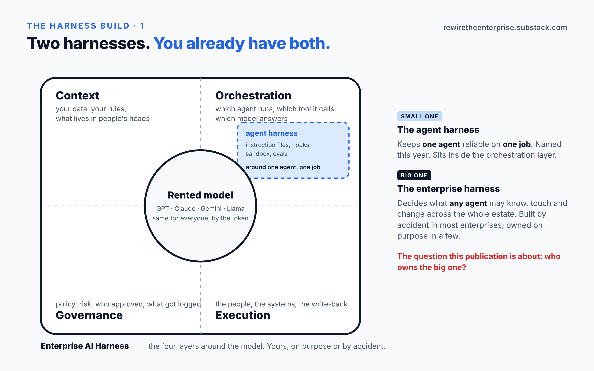

<!-- Rewire the Enterprise · The Harness Build · week 1 · Thu 2026-10-22 11:00 CT -->

# Two harnesses

*One keeps a coding agent honest. The other decides what any agent can know, touch and change across your whole estate. You already have both. You own neither.*

Back in February, a post out of OpenAI put a name on something a lot of us had been doing by feel: harness engineering. The instruction files, the hooks, the sandbox, the tests that run before an agent's code gets anywhere near main. A few months later Birgitta Böckeler boiled it down to 4 words: agent = model + harness.

I like that definition. It's correct. It's also small.

It describes the thing wrapped around one agent doing one job. Call it the agent harness. If you've put a coding agent to work this year, you've built one, probably without naming it.

Now zoom out to what's around that.

## The bigger one

Your enterprise rents a model. So does your competitor. Same GPT, same Claude, same Gemini, same price per token. The model can't tell you apart, and it doesn't try to.

What's yours is everything around it.

**Context.** Your data, your rules, the stuff that lives in people's heads.

**Orchestration.** Which agent runs, which tool it calls, which model answers. The agent harness lives in here.

**Governance.** Policy, risk, who approved, what got logged.

**Execution.** The people, the systems, the write-back.

Those four around a rented model are what I call the Enterprise AI Harness.

The agent harness keeps one agent reliable. The enterprise harness decides what any agent may know, touch and change across hundreds of applications and decades of data. One is a tooling question. The other is an architecture, and it's the one this publication is about.

## You already have one

Here's the part that took me a while to accept. Every enterprise running a model in production already has an enterprise harness. It got built by accident.

Someone pasted a policy document into a system prompt. That's your context layer. Someone wrote 40 lines of glue to call the model from the claims system. That's orchestration. Someone replied "looks good" to an email. That's governance.

A 2026 study of Global 2000 technology leaders puts it at roughly 8 in 10 running a model in production, and roughly 1 in 4 treating the context it runs on as something they own.¹

The gap between those two numbers is the accidental harness. It leaks in three places. Into the vendor's platform, which now holds your workflow logic. Out the door with the employee who never wrote the judgment down. And into nothing at all, with the run that made a decision and left no log. A regulator will ask about that last one.

## The claim

So here's the claim this whole publication rests on, the one I'll have to defend every Thursday.

The enterprise should own its harness, from the driver's seat. Partners can help build it. Vendors can supply pieces of it. The wheel stays with the enterprise, because whoever builds the harness learns the business: the context, the decisions, the audit trail.

Owning it comes down to 4 things. Your context. Your workflow logic. Your telemetry. And the freedom to swap the model, which is the test of the other 3: if changing the model means a rewrite, something that should've been yours has leaked into the model layer.

That's written up properly as the ownership model in the repo. Which brings me to the repo.

## What I'm doing about it

I'm an architect, 25 years in. I've directed AI builds on Vertex AI and I haven't written production code since 2014. So I'm going to build one of these, small, in public, spec first, and write up every decision as it happens. A reference, never the reference.

The repo opened this morning: **github.com/kallolb75/enterprise-ai-harness**.

It has no runtime. That's on purpose. An audit this year of 246 public agent repos found 6 in 10 had no tests or evals at all,² and I'd rather not add to that pile. So the first phase is design: the ownership model, the decision records, a reference architecture, a spec for every piece, and the eval suite wired in before there's anything for it to pass.

Three things in it today are worth your 10 minutes.

**ADR-000** says how every later decision gets made. The part I care about most: every control in the harness carries a reason and an expiry condition. "Never" doesn't count as an expiry. A control that can't expire is how harness rot starts, and most estates are full of rules that exist because of a model that was retired 2 versions ago.

**The ownership model** is the claim above, written so you can disagree with a specific sentence.

**The eval-first rule.** Nothing is done until an eval says so, and when the model gets swapped the whole suite runs again. That's how the freedom to swap the model gets proven, with a passing suite in the log.

The first running code will be the model gateway. It ships when its eval is green. That's the only kind of date I'll give for code.

## Next Thursday, and a question for you

Next week: the reference architecture, v0.1. Four layers around a rented model, where the rented line sits, and one request walked through every layer.

Something to try before then. Name the oldest system in your estate an agent would have to touch to do anything useful. Then ask who'd have to approve that, and where the approval would be written down. If the answer is "an email", you've found your accidental harness.

Put it in the comments. In 3 weeks the first lens essay opens with what you answered.

---

¹ 2026 study of Global 2000 technology leaders, figures rounded.
² Marmelab, 2026 audit of 246 public agent repositories.
